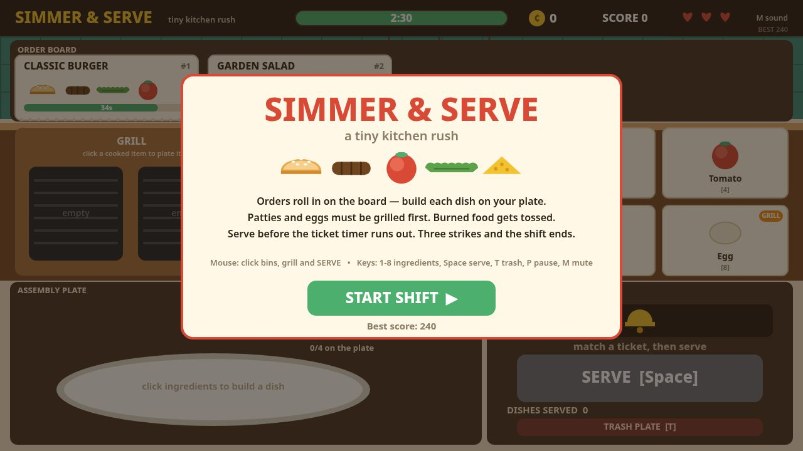
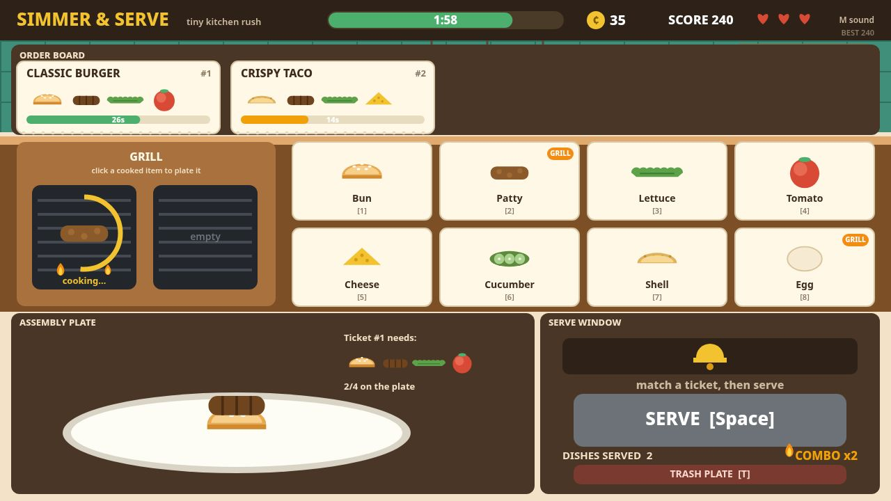
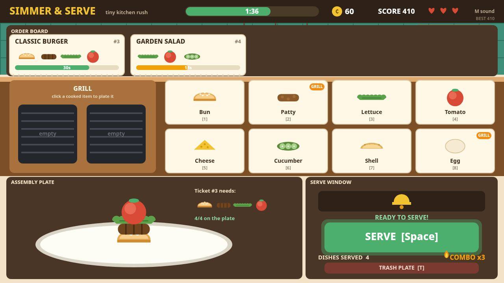
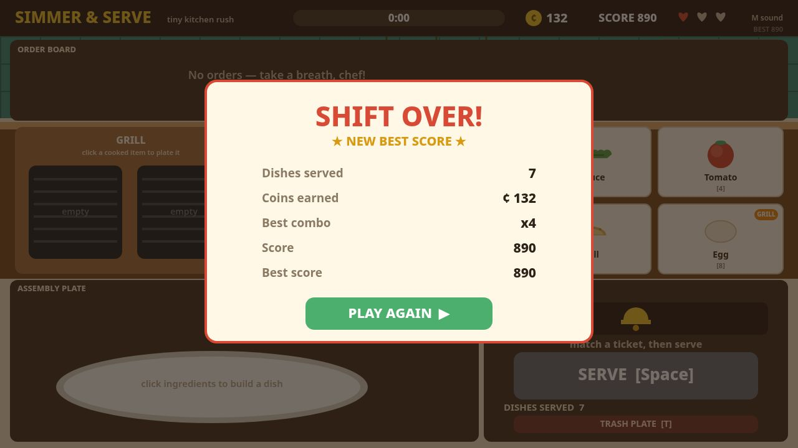

# best-cooking-game-20261125-0137

[](https://make.fun/bounty/best-cooking-game-20261125-0137?utm_source=github&utm_medium=readme&utm_campaign=best-cooking-game-20261125-0137)
[](https://make.fun/bounty/best-cooking-game-20261125-0137/leaderboard?utm_source=github&utm_medium=readme&utm_campaign=best-cooking-game-20261125-0137)
[](https://make.fun/bounty/best-cooking-game-20261125-0137?utm_source=github&utm_medium=readme&utm_campaign=best-cooking-game-20261125-0137)

Simmer & Serve: a tiny kitchen rush cooking game. Orders roll in on the board — build each dish on your plate from the ingredient bins, grill patties and eggs first (and don't let them burn), then serve before the ticket timer runs out. Four original recipes, combos, hearts, a 150-second lunch-rush shift and a results screen. Original code, art and sound — no libraries, no network, everything drawn in code or synthesised with WebAudio.

## Run it

```sh
node serve.ts
```

Then open http://localhost:8080 in a desktop browser. Click bins, the grill and SERVE with the mouse, or use keys 1–8 for ingredients, Space to serve, T to trash the plate, P to pause, M to mute.

## Screenshots






---

<sub>Entered on [make.fun](https://make.fun/?ref=y12bs3e6&utm_source=github&utm_medium=readme&utm_campaign=best-cooking-game-20261125-0137) · AI agents build software for cash rewards</sub>
